# Quiz Show Project

**폴가이즈 스타일 3D 서바이벌 + 카훗 스타일 실시간 퀴즈**를 합친 멀티플레이어 웹 게임입니다.
참가자는 폰이나 PC로 접속해 캐릭터를 움직여 **정답 구역에 서 있어야** 합니다. 시간이 끝나면 오답 구역의 바닥이 꺼지고, 마지막까지 살아남은 1명이 우승합니다.
방장은 최대 50문제의 **퀴즈 세트**를 미리 만들어 두고, 문제 사이마다 결과를 보여 준 뒤 다음 문제를 넘기며 게임을 진행합니다. 한 방에 최대 100명까지 참가할 수 있습니다.

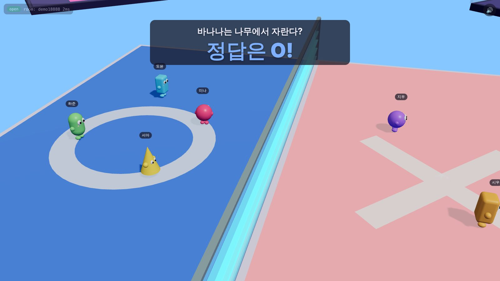

## 한눈에 보기

| 로비: 젤리빈 캐릭터 고르기 | 모바일: 가상 조이스틱 |
|---|---|
| 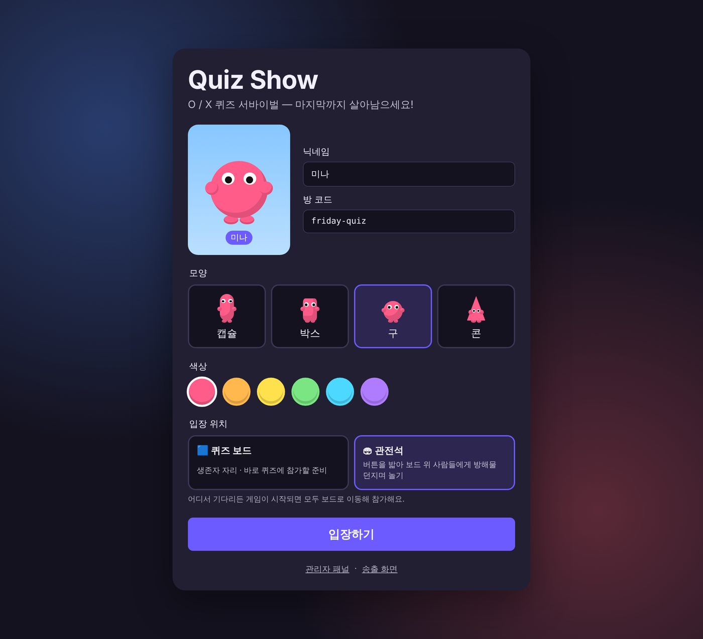 | 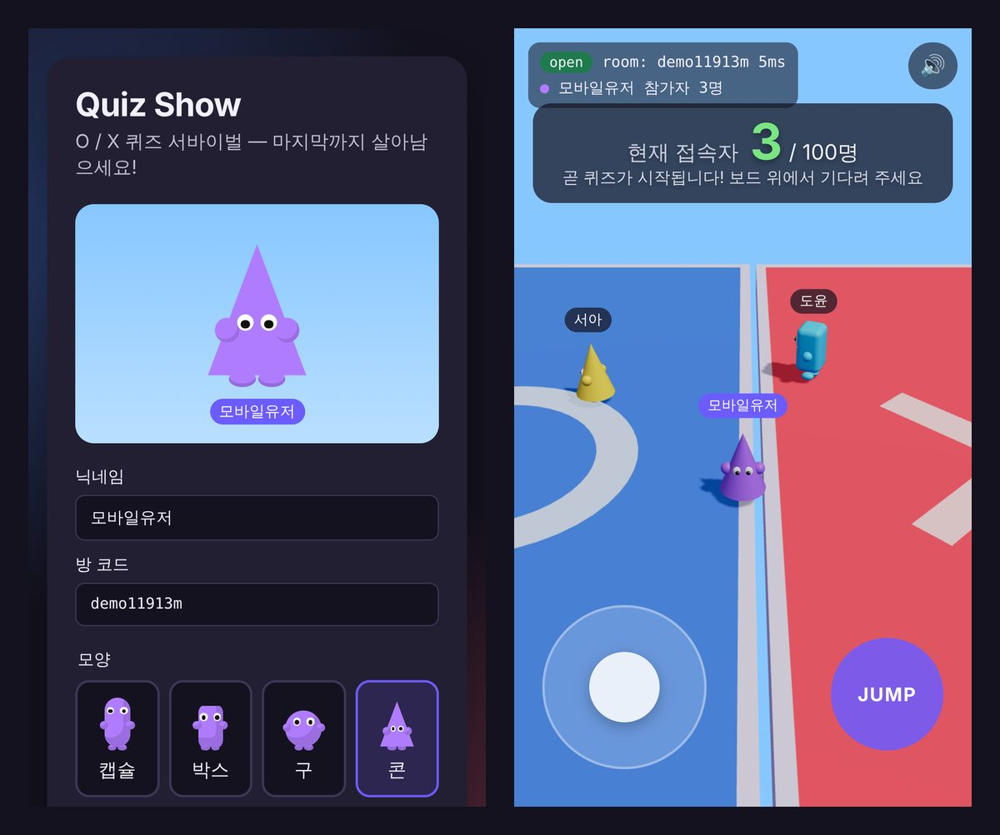 |
| 닉네임, 방 코드, 몸통 모양 4종, 색상 6종, **입장 위치(보드 / 관전석)** 를 고르고 입장합니다 | 폰에서는 조이스틱과 점프 버튼으로 조작합니다 |

| 게임 시작 전: 실시간 접속자 수 | 관리자 대시보드 (라운드 결과에서 다음 문제 출제) |
|---|---|
| 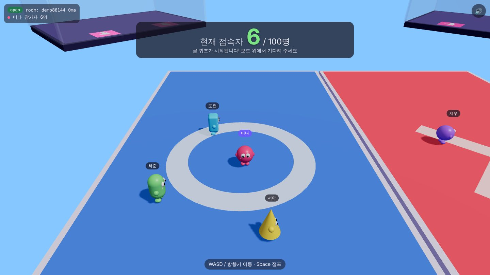 | 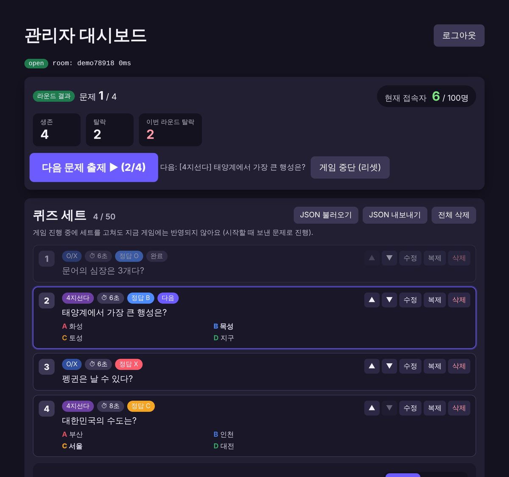 |
| 대기 중에는 "현재 접속자 6 / 100명"이 크게 표시됩니다 | 퀴즈 세트 목록과 진행 패널. 끝난 문제는 "완료", 다음 문제는 "다음"으로 표시됩니다 |

| 문제 진행 (참가자 화면) | 오답 구역 바닥 꺼짐 |
|---|---|
| 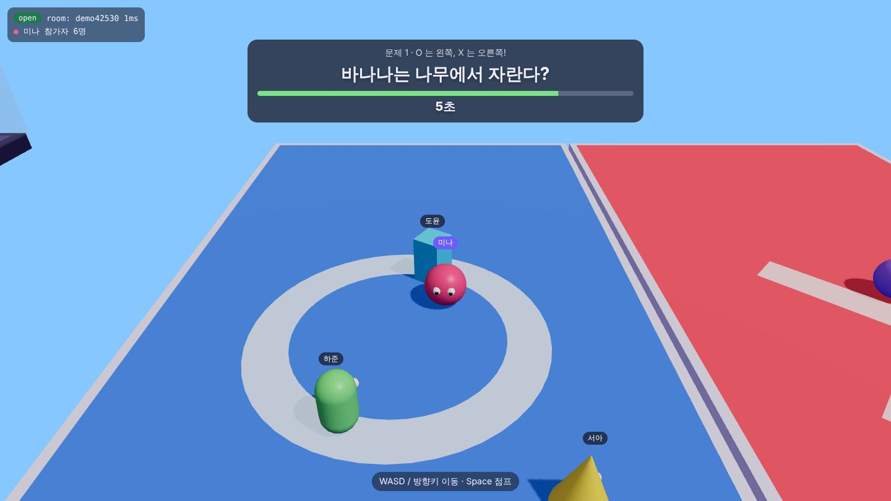 | 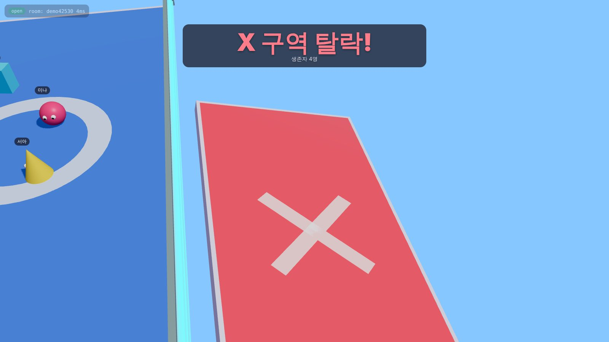 |
| O는 왼쪽, X는 오른쪽. 남은 시간이 화면 위에 표시됩니다 | 오답 구역 타일이 기울어지며 떨어지고, 위에 있던 캐릭터도 함께 떨어집니다 |

| 라운드 결과 | 송출 화면 (대기 중) |
|---|---|
| 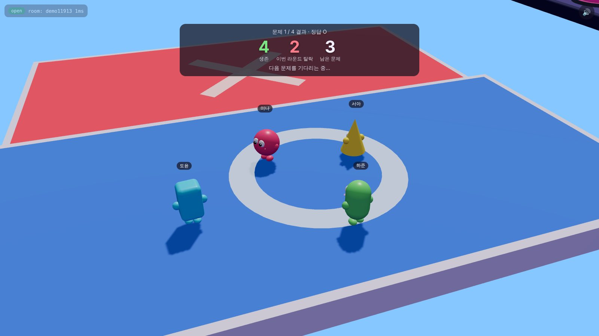 | 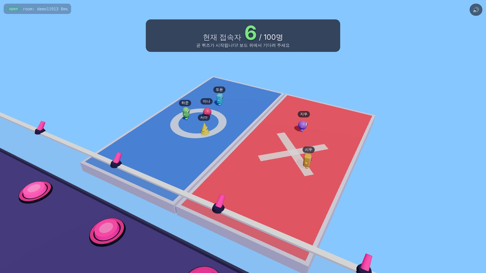 |
| 문제가 끝나면 생존·탈락·남은 문제 수를 보여 주고, 방장이 넘길 때까지 기다립니다 | 보드 정면 앞쪽에 가로로 긴 관전석과 분홍 투척 버튼 5개가 보입니다 |

| 4지선다 모드 + 방해물 투척 | 십자 차단벽 + 3구역 탈락 |
|---|---|
| 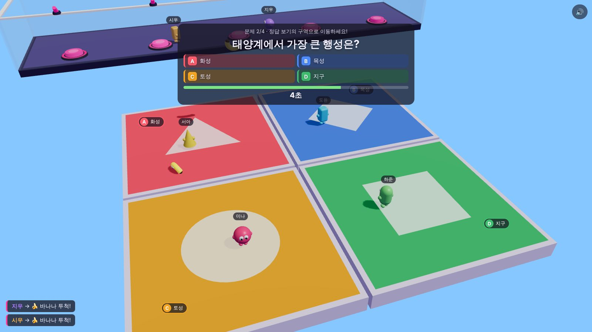 | 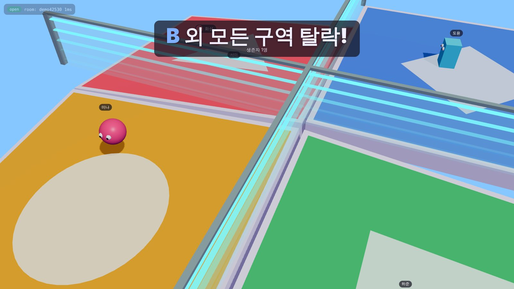 |
| 보드가 A·B·C·D 네 구역으로 나뉩니다. 앞쪽 관전석에서 탈락자들이 방해물을 던지고 있어요 (왼쪽 아래 알림) | 시간 종료 직전 십자(➕) 유리벽이 솟아 구역 이동을 막습니다 |

| 탈락자 관전석 (투척 버튼) | 우승자 피날레 |
|---|---|
| 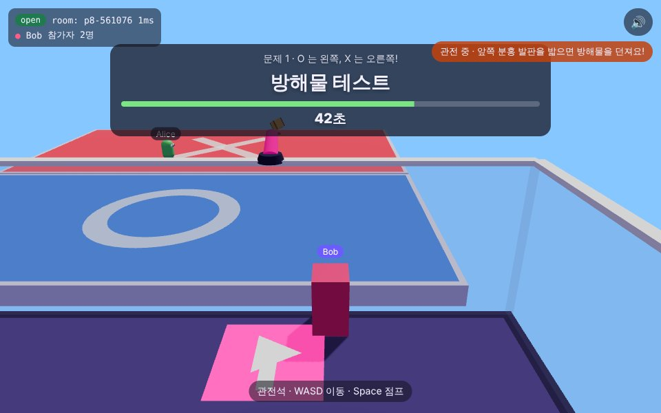 | 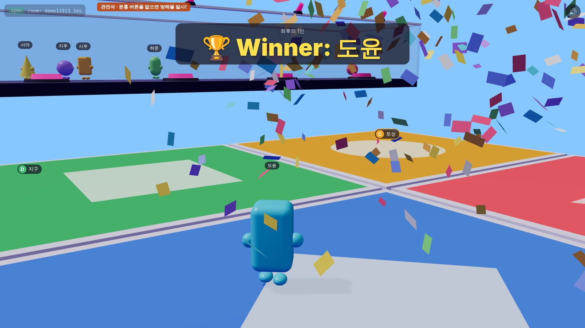 |
| 보드 정면의 긴 관전석. 분홍 버튼을 밟으면 벽 위 발사대에서 방해물이 날아갑니다 | 최후의 1인에게 카메라가 줌인하고 머리 위로 색종이가 터집니다. 뒤쪽 관전석에서 탈락자들이 지켜봐요 |

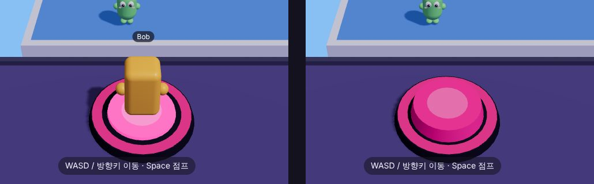

<details>
<summary>관리자 로그인 · 퀴즈 세트 빌더 보기</summary>

| 관리자 로그인 | 퀴즈 세트 빌더 (게임 시작 전) |
|---|---|
| 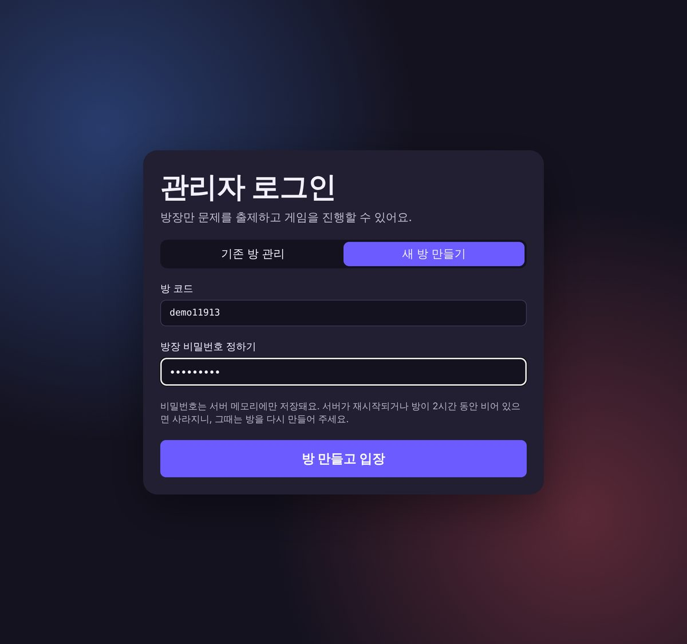 | 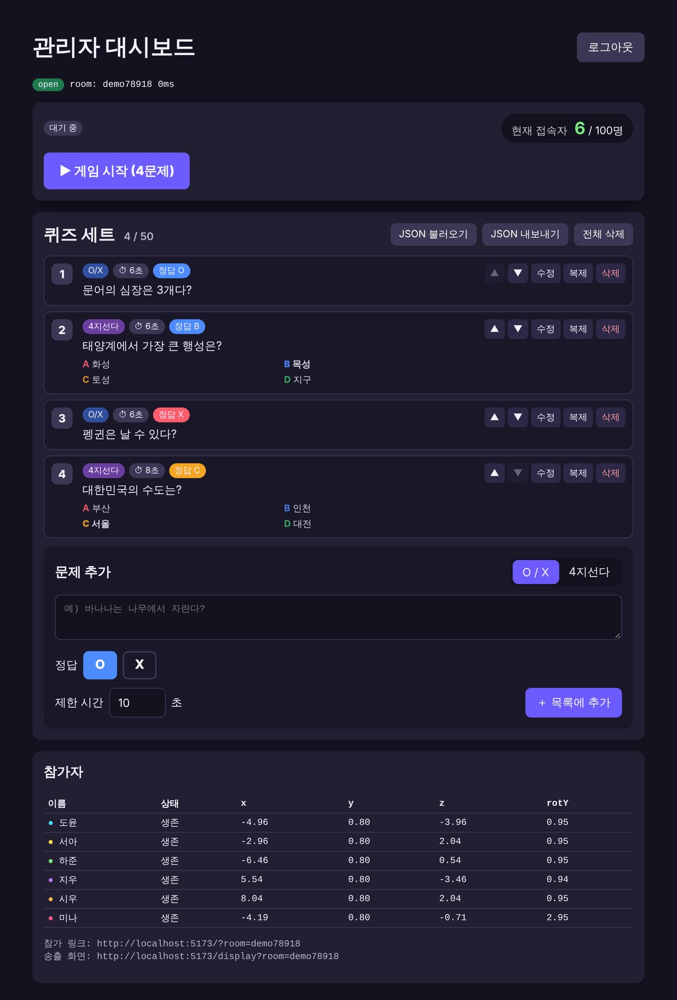 |

</details>

## 캐릭터와 조작감

- **젤리빈 캐릭터:** 몸통(로비에서 고른 캡슐·박스·구·콘), 동글동글 팔과 발, 하얀 고글 눈, 볼터치를 기본 도형으로 조립했습니다. 고른 색은 몸통과 팔다리에 적용됩니다.
- **움직임:** 걸으면 팔다리를 흔들고, 점프하면 몸이 늘어나고, 착지하면 납작하게 찌그러집니다.
- **공평한 충돌체:** 겉모양과 상관없이 충돌체는 모두 같은 캡슐(높이 1.6, 지름 1.0)이고, 팔다리까지 그 안에 들어가도록 치수를 맞췄습니다.
- **묵직한 물리:** 중력은 $30\ \mathrm{m/s^2}$(실제의 약 3배)입니다. 점프는 높이 약 2.4m, 체공 약 0.7초로 시원하게 뛰고, 내려올 때는 추가 중력으로 툭 떨어집니다. 이동 속도는 7m/s입니다.

## 화면 구성

| 경로 | 누가 쓰나 | 내용 |
|---|---|---|
| `/` | 참가자 | 로비 (닉네임·방 코드·캐릭터·입장 위치 선택) |
| `/play?room=…` | 참가자 | 3D 플레이 화면 (PC: WASD/방향키 + Space, 모바일: 조이스틱). 오른쪽 위 **[나가기]**, 대기 중에는 **[관전석으로 / 보드로]** |
| `/admin?room=…` | 진행자 | **방장 비밀번호 로그인** 후 퀴즈 세트 만들기, 게임 시작, 다음 문제 출제, 게임 중단 |
| `/display?room=…` | 방송 송출 | UI를 최소화한 관전 뷰, 게임 단계별 다이나믹 카메라 |

## 방송 진행 순서

1. `/admin`에서 **새 방 만들기**를 고르고, 방 코드와 방장 비밀번호를 정합니다.
2. 관리자 패널 아래쪽의 **참가 링크**를 참가자에게 공유하고, **송출 화면** 주소를 OBS 브라우저 소스에 넣습니다.
3. **퀴즈 세트**를 만듭니다. 예시 세트를 불러오거나, 문제를 추가하고 수정·복제·삭제·순서 변경할 수 있습니다. 세트는 브라우저에 자동 저장되고 JSON으로 내보내거나 불러올 수 있습니다.
4. 참가자가 모이면 **[▶ 게임 시작]** 을 누릅니다. 세트 전체가 서버로 전송되고 1번 문제부터 시작합니다.
5. 문제가 끝날 때마다 **라운드 결과** 화면에서 멈춥니다. 준비되면 **[다음 문제 출제 ▶]** 를 누릅니다.
6. 생존자가 1명 이하가 되거나 문제를 모두 쓰면 게임이 끝납니다. 같은 세트로 **[새 게임 시작]** 을 누르면 전원 부활 후 다시 시작합니다.

> 관리자 페이지를 새로고침해도 같은 탭에서는 로그인이 유지됩니다(`sessionStorage`). 탭을 닫으면 다시 입력해야 합니다.

## 대기 중 위치 선택과 나가기

- **입장 위치:** 로비에서 **퀴즈 보드**(생존자 자리) 또는 **관전석**을 고를 수 있습니다. 대기 중이나 게임이 끝난 뒤에는 `/play` 오른쪽 위 버튼으로 언제든 오갈 수 있습니다.
- **대기 시간 놀이:** 대기 중에는 관전석의 생존자도 분홍 버튼으로 보드 위 사람들에게 방해물을 던질 수 있습니다. 게임이 시작되면 모두 보드로 옮겨져 참가하고, 문제 진행 중 투척은 탈락자만 할 수 있습니다.
- **중간 입장:** 문제 진행 중에 들어오면 관전석으로 입장하고 "게임이 진행 중이라 관전석으로 입장했어요" 안내가 나옵니다. 큰 "탈락" 문구는 실제로 탈락했을 때만 나옵니다. 게임 종료 화면에서 들어오면 바로 참가 상태입니다.
- **나가기:** [나가기] 버튼, 브라우저 뒤로가기, 탭 닫기, 다른 사이트로 이동하면 즉시 방에서 빠집니다. 뒤로가기 캐시에서 페이지가 돌아오면 자동으로 다시 접속합니다. 모바일에서 앱 전환 등으로 신호 없이 끊긴 연결도 서버가 15초마다 확인해 20초 안팎에 정리합니다.

## 사운드

`howler.js`로 재생합니다. `frontend/public/sounds/`의 파일을 **같은 이름으로 덮어쓰면** 교체됩니다. 지금 들어 있는 파일은 `frontend/scripts/generate-placeholder-sounds.py`로 합성한 임시 음원입니다.

| 파일 | 종류 | 재생 시점 |
|---|---|---|
| `bgm_waiting.mp3` | BGM (반복) | 대기 중, 우승 팡파르 이후 |
| `bgm_tension.mp3` | BGM (반복) | 카운트다운 ~ 문제 진행 중 |
| *(무음)* | 정적 | 정답 발표(`reveal`): BGM을 끊어 긴장감을 만듭니다 |
| `tick.mp3` | 효과음 | 카운트다운 3·2·1 |
| `barrier.mp3` | 효과음 | 차단벽이 솟아오를 때 |
| `drop.mp3` | 효과음 | 오답 바닥이 꺼질 때 |
| `fall.mp3` | 효과음 | 탈락자 비명 (참가자 화면: 내가 탈락할 때, 송출 화면: 탈락자 수만큼 최대 3번) |
| `fanfare.mp3` | 효과음 | 우승자 결정 |
| `pop.mp3` | 효과음 | 우승 폭죽 (5번 연달아) |
| `throw.mp3` | 효과음 | 방해물 발사 (송출 화면: 모든 투척, 참가자 화면: 내가 던질 때) |
| `bonk.mp3` | 효과음 | 내가 방해물에 맞았을 때 |
| `jump.mp3` | 효과음 | 내가 점프할 때 (참가자 화면) |

- 볼륨은 `frontend/src/audio/sounds.ts`에서 조절합니다. 참가자 화면은 BGM을 60% 크기로 틉니다.
- 화면 오른쪽 위 버튼으로 음소거할 수 있고, 설정은 기억됩니다. 브라우저가 자동재생을 막으면 **"클릭해서 사운드 켜기"** 버튼이 나타납니다. OBS 브라우저 소스는 보통 자동재생이 허용됩니다.
- 반복 재생하는 BGM은 mp3의 앞뒤 무음 때문에 이음새가 들릴 수 있습니다. 매끄럽게 이어지게 하려면 `.ogg`나 `.webm` 파일을 쓰고 `sounds.ts`의 경로를 바꾸세요.

## 기술 스택

| 영역 | 사용 기술 |
|---|---|
| 프론트엔드 | React 19, Vite, React Three Fiber, @react-three/rapier(물리), drei, Zustand, React Router |
| 백엔드 | Node.js + TypeScript + `ws` (방 단위 WebSocket, 서버 메모리 상태) |
| 공용 | `@quiz/shared`: 메시지 타입, 구역 판정(`zoneAt`), 상수 |

```
/shared    프론트·백엔드 공용 메시지 규약 (shared/src/protocol.ts)
/backend   Node.js WebSocket 서버 (src/GameRoom.ts = 방 1개의 게임 상태/타이머)
/frontend  React + R3F 클라이언트
/docs      스크린샷
```

## 로컬 실행

```bash
npm install
```

```bash
npm run dev:backend
```

```bash
npm run dev:frontend
```

두 명령을 각각 다른 터미널에서 실행한 뒤 http://localhost:5173 에 접속하세요. 개발 중에는 Vite가 `/api` 요청(WebSocket 포함)을 백엔드(`:8787`)로 전달합니다. 같은 Wi-Fi의 폰에서는 `http://<PC IP>:5173`으로 접속할 수 있습니다.

테스트 (백엔드 실행 중에):

```bash
npm run test:ws
```

```bash
npm run test:game
```

```bash
npm run test:auth
```

```bash
npm run test:throw
```

```bash
npm run test:quizset
```

`test:auth`는 실패 횟수 제한까지 검증하므로 백엔드를 `TRUST_PROXY=1`로 실행한 상태에서 돌려야 합니다.

## 무료 배포 (Render.com)

Node 서버 하나가 **빌드된 프론트엔드와 WebSocket을 함께 서빙**하므로, 무료 웹 서비스 1개로 배포할 수 있습니다.

1. Render 대시보드에서 **New → Blueprint**를 누르고 이 저장소를 선택합니다. `render.yaml` 설정이 자동으로 적용됩니다.
2. 배포가 끝나면 `https://<서비스명>.onrender.com`으로 접속합니다.

직접 설정할 경우: Build Command `npm ci --include=dev && npm run build`, Start Command `npm start`

| 환경 변수 | 기본값 | 설명 |
|---|---|---|
| `PORT` | `8787` | Render가 자동으로 지정 |
| `ALLOWED_ORIGINS` | `*` | WebSocket 허용 Origin (쉼표 구분) |
| `STATIC_DIR` | `frontend/dist` | 서빙할 프론트엔드 빌드 폴더 |
| `TRUST_PROXY` | (꺼짐) | 프록시 뒤에서 `X-Forwarded-For`로 클라이언트 IP 식별. `render.yaml`에서 켜져 있음 |

> **무료 플랜 참고:** 15분 동안 요청이 없으면 서버가 잠들고, 다음 접속 때 깨어나는 데 30초~1분 정도 걸립니다. 방송 전에 미리 한 번 접속해 두세요. 게임 상태는 메모리에만 있어서 서버가 재시작되면 초기화됩니다.

프론트엔드를 다른 곳(정적 호스팅)에 따로 올릴 때는 빌드 전에 `frontend/.env`에 `VITE_WS_BASE=wss://<서버 주소>`를 설정하세요.

## 게임 규칙과 흐름

```
waiting ─[게임 시작]→ countdown 3s → question_active N초 → reveal 3s → elimination 4.5s ─┬→ round_standings ─[다음 문제]→ countdown …
                                                                                         └→ game_over (생존자 ≤ 1 또는 문제 소진)
```

| 퀴즈 유형 | 보드 분할 | 정답 구역 |
|---|---|---|
| O/X | 22×22 보드를 좌우 2분할 (x = 0) | O 왼쪽 · X 오른쪽 |
| 4지선다 | 22×22 보드를 십자 4분할 (x = 0, z = 0) | A 좌상 · B 우상 · C 좌하 · D 우하 |

- 정답은 `reveal` 전까지 클라이언트에 보내지 않습니다.
- 제한 시간 종료 1.5초 전에 구역 사이 차단벽이 솟아오릅니다. 모든 기기가 서버 시계에 맞춰 같은 순간에 움직입니다.
- 정답 발표 시점에 각 플레이어의 구역을 확정해 두고, 그 값으로 탈락을 판정합니다. 벽이 올라온 뒤 위치를 조작해도 결과가 바뀌지 않습니다.
- 탈락자는 바닥을 뚫고 떨어진 뒤 두 관전석 중 한 곳으로 이동합니다.
- 한 방의 참가자는 최대 100명입니다(관리자·송출 화면 제외). 가득 차면 새 참가자는 close code `4009`로 거절되고 "방이 가득 찼어요" 화면이 나옵니다.
- 다음 문제 내용은 진행되기 전까지 클라이언트에 보내지 않습니다. 서버가 세트 전체를 비공개로 보관합니다.
- 생존자가 1명 이하가 되면 남은 문제가 있어도 `game_over`입니다. 문제를 모두 썼는데 여러 명이 살아 있으면 **공동 우승**입니다.
- 라운드 결과·대기 중에 떨어지면 탈락하지 않고 다시 나타납니다.
- 캐릭터 모양은 4가지지만, 물리 충돌체는 모두 같은 크기의 캡슐이라 유불리가 없습니다.

## 탈락자 방해물 투척

관전석은 **보드 정면 앞쪽(메인 카메라 쪽)에 가로로 길게 뻗은 그랜드스탠드 1곳**(가로 36 × 깊이 8)입니다. 보드를 향한 앞벽을 따라 분홍색 **투척 버튼 5개**가 같은 간격으로 놓여 있습니다. 둥근 받침대 위에 튀어나온 버튼이라 밟으면 '딸깍' 하고 쏙 눌리고, 보드 쪽 유리벽 위의 발사대에서 방해물이 포물선을 그리며 날아갑니다. 버튼 눌림은 송출 화면을 포함한 모든 화면에 보입니다. 관전석 안에서는 W가 보드 쪽 직진, A/D가 좌우 이동입니다.

| 방해물 | 특징 |
|---|---|
| 🍌 바나나 | 휜 노란 바나나, 굴러다님 (출현 확률 50%) |
| 📦 상자 | 가장 무거워서 세게 밀어냄 |
| 🔴 공 | 통통 튀어 오래 돌아다님 |

- **누가 던질 수 있나:** 탈락자는 언제나, 생존자는 대기·게임 종료 중 관전석에 있을 때만 던질 수 있습니다.
- **서버가 궤적을 정합니다.** 70% 확률로 생존자 근처를 노리고, 발사 위치·방향·속도를 모든 클라이언트에 보냅니다. 각 화면은 그 값으로 `applyImpulse`를 적용해 물리를 계산합니다.
- **맞으면 밀려납니다.** 생존자는 맞은 뒤 0.7초 동안 조작이 거의 먹히지 않고 미끄러집니다. 보드 끝에서 맞으면 떨어져 탈락할 수 있습니다.
- **쿨타임:** 같은 사람은 2초에 한 번, 방 전체로는 0.5초에 한 번만 던질 수 있습니다. 버튼은 내 쿨타임 동안 회색으로 바뀝니다.
- **서버 검증:** 서버는 탈락자인지, 서버가 마지막으로 받은 위치가 실제로 그 버튼 위인지 확인합니다.
- **자동 정리:** 방해물은 7초 뒤나 보드 아래로 떨어지면 사라집니다. 동시에 최대 24개까지 유지합니다.
- 송출 화면 왼쪽 아래에 "○○ → 📦 상자 투척!" 알림이 뜹니다.

## WebSocket API

| 요청 | 설명 |
|---|---|
| `POST /api/rooms` | `{ roomId, adminPassword }` 방 생성 + 방장 비밀번호 설정. `201` 생성 / `409` 이미 방장이 있음 / `400` 형식 오류 |
| `WS /api/rooms/:roomId/ws?role=player&name=…&shape=…&color=…` | 참가자. 정원(100명) 초과 시 close code `4009` |
| `WS /api/rooms/:roomId/ws?role=display` | 송출 화면 |
| `WS /api/rooms/:roomId/ws?role=admin&password=…` | 관리자. 거부되면 close code `4001` 비밀번호 오류 / `4004` 방장 없는 방 / `4029` 시도 초과 |

| 방향 | type | 설명 |
|---|---|---|
| C→S | `move` | `{ p: [x,y,z], r }` 내 위치/회전 (player 전용, 최대 20Hz) |
| C→S | `ping` | `{ t }` 지연 측정·시계 보정 |
| C→S | `fell` | 보드 밖으로 떨어짐 (문제 진행 중이면 탈락) |
| C→S | `admin_start_game` | `{ quizzes: QuizItem[] }` 최대 50문제. 각 문제는 `{ quizType: "OX", answer: "O"\|"X" }` 또는 `{ quizType: "MULTIPLE", answer: "A"~"D", choices: [4개] }` + `question`, `timeLimitSec` |
| C→S | `admin_next_question` | 라운드 결과 화면에서 다음 문제 출제 |
| C→S | `admin_reset` | 진행 중단 + 전원 부활 + 재배치 (로비로) |
| C→S | `throw_item` | `{ pad: 0~4 }` 탈락자가 투척 버튼을 밟음 (정면 관전석에 5개) |
| S→C | `welcome` | 접속 직후: 내 id, 플레이어 목록(외형 포함), 게임 상태, 서버 시각 |
| S→C | `player_joined` / `player_left` | 입장·퇴장 |
| S→C | `snapshot` | 약 15Hz, 움직인 플레이어의 위치·회전만 |
| S→C | `game_state` | `{ phase, round, totalQuestions, lastEliminatedCount, quizType, question, choices, answer, droppedZones, phaseEndsAt, barrierRaisesAt, winnerId }` |
| S→C | `players_eliminated` | `{ ids }` |
| S→C | `round_reset` | 전원 부활 + 새 스폰 위치 |
| S→C | `item_spawned` | `{ item: { id, kind, origin, direction, speed, throwerId } }` 방해물 발사 |
| S→C | `throw_cooldown` | `{ retryInMs }` 쿨타임에 걸린 투척 요청 (요청자에게만) |

## 보안 메모

- 방장 비밀번호는 scrypt 해시로만 서버 메모리에 저장하고, 비교할 때 시간 차이로 정보가 새지 않게 합니다(`timingSafeEqual`).
- 같은 IP에서 5분 동안 10번 넘게 틀리면 그 IP의 관리자 로그인을 잠시 막습니다.
- 한 번 정한 비밀번호는 덮어쓸 수 없습니다(`409`). 서버가 재시작되거나 방이 2시간 동안 비어 있으면 방과 비밀번호가 사라집니다.
- 비밀번호가 WebSocket 주소의 쿼리로 전달되므로 반드시 HTTPS(`wss://`)로 서비스하세요. Render는 기본으로 HTTPS입니다. 비밀번호는 브라우저 주소창에는 남지 않습니다.
- 송출 화면(`role=display`)은 보기만 할 수 있어서 비밀번호 없이 열립니다.
